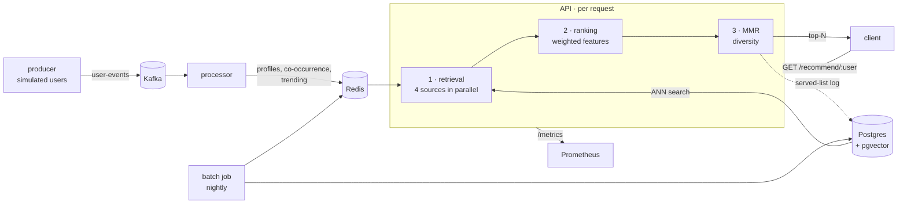

# Real-Time Recommendation Engine

[](https://github.com/1morshed1/reco-engine/actions/workflows/ci.yml)

[](LICENSE)

A recommendation **serving** system in Go. User activity streams in through
Kafka, becomes live user profiles and item statistics in Redis, and an HTTP API
answers recommendation requests in single-digit milliseconds. Each request runs a
two-stage **retrieval → ranking → diversity** pipeline over a movie catalog
stored in Postgres, using pgvector for approximate-nearest-neighbour search.

**Highlights**

- **p50 4.2 ms / p99 8.5 ms** per request, against a 50 ms target. Throughput
  reaches ~1,500 req/s on a single laptop that also runs Kafka, Redis and Postgres.
- **Beats the popularity baseline** on precision, recall and nDCG in a
  leakage-free offline evaluation, with **~30× the catalog coverage** (0.21 vs
  0.007).
- **Four candidate sources fan out in parallel** (embedding ANN, co-occurrence,
  trending, fresh), then a weighted feature ranker and MMR diversification.
- **Event-driven online state.** A Kafka consumer keeps user taste vectors,
  "also viewed" counts and time-decayed trending scores up to date in Redis.
- **Graceful cold start.** A brand-new user is served from trending and fresh
  items, with no special case in the request path.
- **Full loop.** Includes a nightly Go batch job, a Prometheus metrics endpoint,
  a load tester and an offline evaluation harness.

## Architecture



Scoring the whole catalog on every request is too slow, so the pipeline has two
stages:

1. **Retrieval** pulls ~200 candidates from four sources concurrently:
   - embedding ANN (content match to the user's taste vector)
   - "users who viewed X also viewed Y"
   - trending in the user's categories
   - fresh items, for exploration

   Each source covers a blind spot of the others. This stage is fast and
   wide but not precise.
2. **Ranking** scores those candidates with a feature formula: similarity,
   popularity, recency, price match, category match, rating and a per-source
   boost. MMR then trades relevance against novelty to pick the final top-N.

The full design rationale is in [`docs/01-architecture-decisions.md`](docs/01-architecture-decisions.md).

## Results

**Offline quality** (`make eval`, time-based train/test split, K=10). Details in [`docs/09`](docs/09-evaluation.md).

| Strategy                       | Precision@10 | Recall@10 | nDCG@10    | Coverage  |
|--------------------------------|-------------:|----------:|-----------:|----------:|
| Popularity (baseline)          | 0.0056       | 0.0077    | 0.0066     | 0.007     |
| Embedding only                 | **0.0074**   | **0.0103**| 0.0082     | 0.189     |
| Full pipeline                  | 0.0072       | 0.0097    | **0.0092** | **0.214** |

The full pipeline has the best ranking quality (nDCG) and catalog coverage. It
avoids the filter bubble that the popularity baseline creates.

**Latency** (`make loadtest`, all services in Docker on one laptop). Details in [`docs/11`](docs/11-benchmarks-and-performance.md).

| Load              | p50     | p90   | p99        | Throughput  | Errors |
|-------------------|--------:|------:|-----------:|------------:|-------:|
| Concurrency 4     | 4.2 ms  | –     | **8.5 ms** | 911 req/s   | 0      |
| Concurrency 50    | 31 ms   | 44 ms | 60 ms      | ~1,500 req/s| 0      |

At concurrency 50, the p99 is limited by CPU contention with the co-located Kafka,
Redis and Postgres containers, not by the pipeline. Dropping to concurrency 4 made
latency fall to single-digit milliseconds, which confirmed it. Item hydration and
fresh-item listing are served from an in-memory catalog, so ANN search is the only
Postgres call on the request path (see `docs/11`).

## Tech stack

| Concern        | Choice                                   | Why |
|----------------|------------------------------------------|-----|
| Serving        | Go                                       | Goroutine fan-out across sources, low and predictable p99 |
| Event bus      | Kafka (KRaft), `segmentio/kafka-go`      | Durable, replayable event log |
| Online state   | Redis (sorted sets, hashes)              | Sub-millisecond reads on the request path |
| Catalog + ANN  | Postgres + pgvector (IVFFlat)               | One store for catalog, logs and vector search |
| Metrics        | Prometheus                               | Request-latency and candidate-pool histograms |
| Batch / eval   | Go commands on cron                      | No Airflow needed at this scale |

## Quick start

Prerequisites: Docker with Docker Compose, and Go 1.25+.

```bash
make up          # start postgres, redis, kafka, prometheus
make seed        # apply schema, load catalog + embeddings, build ANN index, history
```

Then run the streaming and serving processes, each in its own terminal:

```bash
make processor   # consume events -> update Redis
make producer    # simulate live user activity into Kafka
make api         # serve recommendations on :8080
```

Query it:

```bash
curl 'http://localhost:8080/api/v1/recommend/42?n=10'      # recommendations
curl -XPOST localhost:8080/api/v1/click \
  -H 'Content-Type: application/json' -d '{"user_id":42,"item_id":1156}'
curl localhost:8080/metrics                                 # Prometheus metrics
```

Evaluation, batch job, load test and checks:

```bash
make eval        # precision@k, recall@k, nDCG, coverage (3 strategies compared)
make batch       # recompute embeddings, rebuild co-occurrence, rescale trending
make loadtest    # throughput + latency percentiles
make test        # unit tests
make lint        # gofmt + go vet (same as CI)
```

## Repository layout

```
cmd/         entrypoints: api, processor, seed, producer, eval, batch, loadtest
internal/
  recommender/   request-time orchestration (profile → retrieve → rank → diversify)
  candidates/    stage 1: parallel multi-source retrieval
  ranking/       stage 2: feature-weighted scoring
  diversity/     MMR re-ranking
  profile/       event → online-state updates (processor)
  catalog/       in-memory catalog cache for the hot path
  store/         postgres (catalog, ANN, logs) and redisstore (online state)
  embedding/ dataset/ events/ metrics/ config/ models/
migrations/  SQL schema (embedded into the binary)
deploy/      Prometheus config
docs/        design notes, one per subsystem
```

## Design notes

[`docs/`](docs/README.md) holds one write-up per subsystem. Each covers the
problem, the options considered, the choice made and its trade-offs. Topics
include the data model, embeddings and ANN, streaming semantics, ranking and
diversity, evaluation methodology, and performance work. Start with
[`docs/00-overview.md`](docs/00-overview.md).

## License

[MIT](LICENSE)
